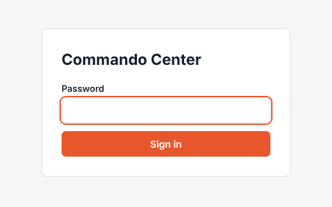
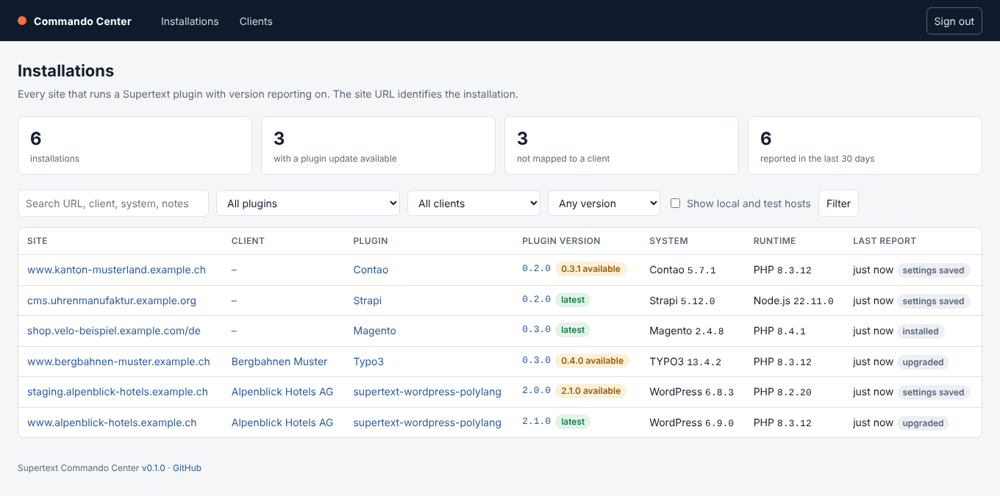
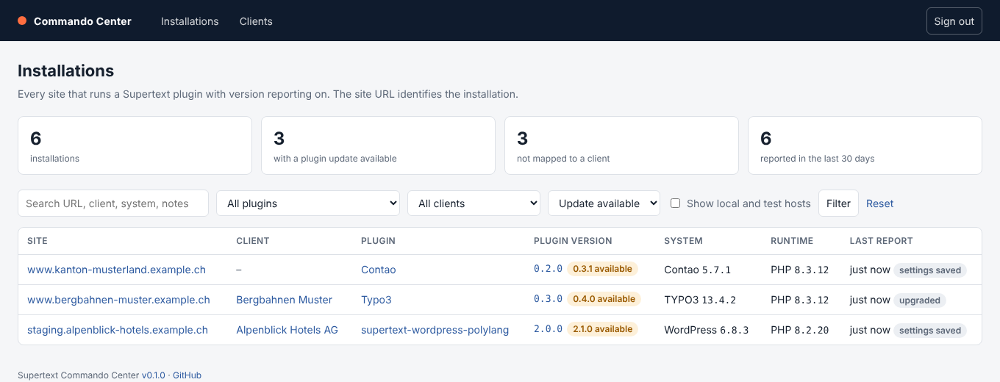
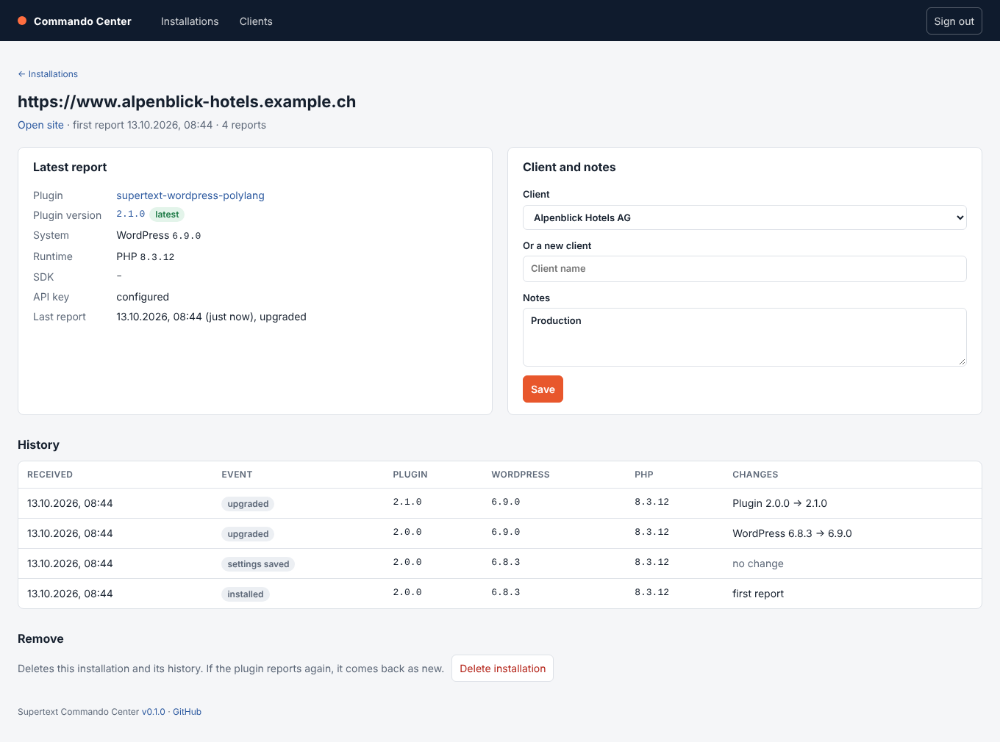
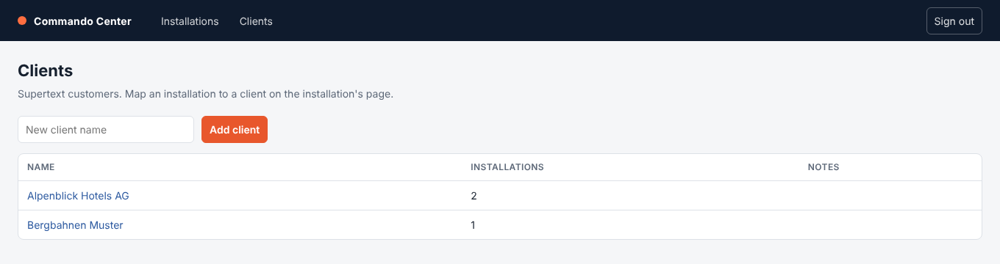
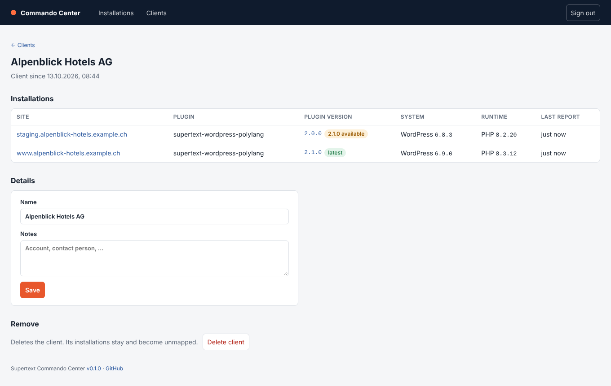

# User guide

The Commando Center shows which Supertext plugin version each customer site runs, on which system and runtime version, and what changed when. This guide is for Supertext staff who look things up and map sites to clients. Setup is in the [installation guide](INSTALLATION.md).

## Sign in

Open the center and enter the shared password. You stay signed in for 14 days on that browser; *Sign out* is at the top right.

## Installations

The start page lists every installation that has reported: one row per site URL and plugin.

| Column | Meaning |
| --- | --- |
| **Site** | The site's URL as the plugin reported it. It identifies the installation; click it for details |
| **Client** | The Supertext customer it is mapped to (by hand, see below) |
| **Plugin** | Which Supertext plugin; links to its GitHub repository |
| **Plugin version** | The installed version, linked to its release notes, with a status: **latest**, **X.Y.Z available** (an update exists), **newer than release** (a development build) or **no release** (no published release found) |
| **System** / **Runtime** | The CMS, shop or PIM with its version, and the PHP, Node.js, … version |
| **Last report** | When the plugin last reported and why: *installed*, *settings saved*, *upgraded* (the plugin, the system or the runtime changed) or *check* |

The counts at the top show how many installations there are, how many have a plugin update available, how many aren't mapped to a client yet, and how many reported in the last 30 days.

### Filters

Search by URL, client, system or notes; filter by plugin, client (or *Not mapped*) and plugin version status. *Update available* answers "who still runs an old version?":

Local and test sites (`localhost`, `*.test`, `*.ddev.site`, private IP addresses, …) are hidden; tick *Show local and test hosts* to see them, for example a developer's installation.

## One installation

The installation page shows the latest report, the client mapping and the history of all reports.

The **History** lists every report, newest first, and what changed compared with the report before: *Plugin 2.0.0 → 2.1.0*, *WordPress 6.8.3 → 6.9.0*, *API key set*. A plugin reports when its settings are saved and after the plugin, the system or the runtime was updated (with the next back-end request after the update).

## Map installations to clients

Plugins only send their URL, so the center doesn't know whose site it is. On the installation page, under **Client and notes**:

- pick an existing client, or
- type a name under *Or a new client* to create one,

add notes if useful (production or staging, contact person) and click **Save**. Map staging and production sites to the same client.

## Clients

*Clients* lists all clients with the number of installations. Add a client with *Add client*, or create it while mapping an installation.

The client page lists the client's installations with their versions, and lets you rename the client and keep notes.

## Delete

- **Delete installation** (installation page) removes it and its history, for example a test site or a site with an outdated URL. If the plugin reports again, it comes back as a new installation.
- **Delete client** (client page) removes the client; its installations stay and become unmapped.

## What the plugins send

The site URL, the plugin, system and runtime versions, the SDK version and whether an API key is set. No content, no API keys and no personal data. Administrators can turn reporting off in each plugin's settings (*Send version information to Supertext*); a site that turned it off stops reporting, and its last report stays in the center.

Anyone who knows the address could send a report, so treat the data as information for support, not as proof.
